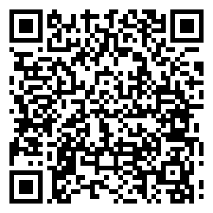
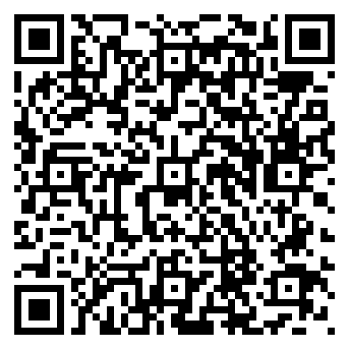

# Sonaria – Downloads

Sonaria ist ein Musik-System, mit dem du deine Musik besitzt statt sie zu streamen.
Hier kannst du die Apps ohne Anmeldung herunterladen.

## Sonaria Store für Android

**[Sonaria-Record-Store.apk herunterladen](https://github.com/techwithfinn/Sonaria-Downloads/releases/download/android-app/Sonaria-Record-Store.apk)**

Oder diesen Code mit dem Handy scannen:

Auf dem Handy die Datei öffnen und „Installieren“ tippen. Läuft ab Android 5.0.
Wenn das Handy fragt, ob es Apps aus dieser Quelle installieren darf: erlauben.

## Sonaria Record Store für Windows

**[Sonaria-Record-Store-Setup.exe herunterladen](https://github.com/techwithfinn/Sonaria-Downloads/releases/download/windows-app/Sonaria-Record-Store-Setup.exe)**

Doppelklicken und installieren. Falls Windows „Der Computer wurde durch Windows geschützt“
zeigt: auf „Weitere Informationen“ und dann „Trotzdem ausführen“ klicken.

---

Die Links bleiben immer gleich und zeigen stets auf die neueste Version.
